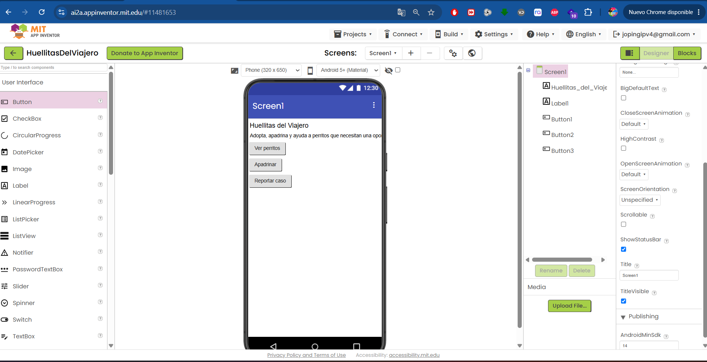
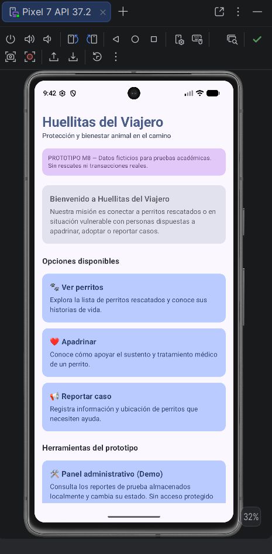
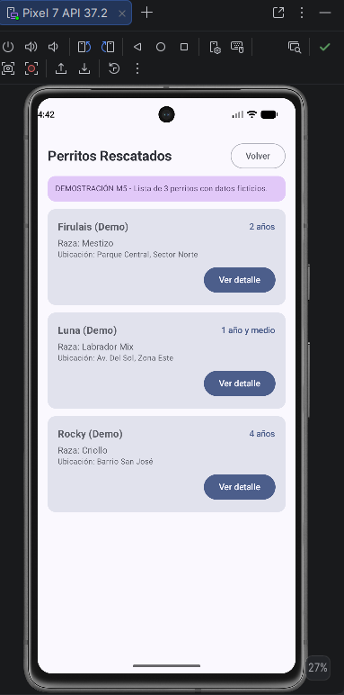
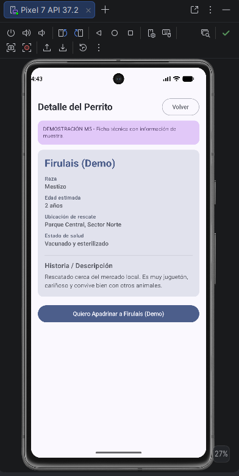
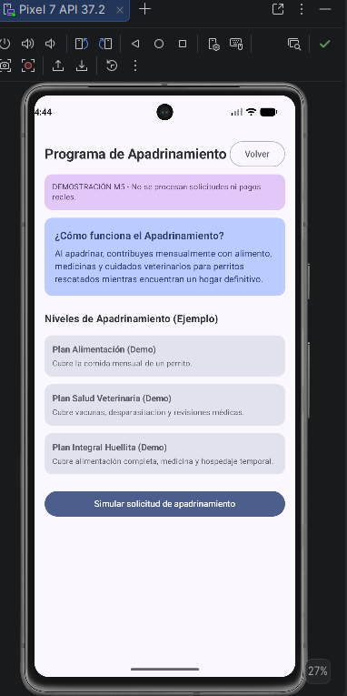
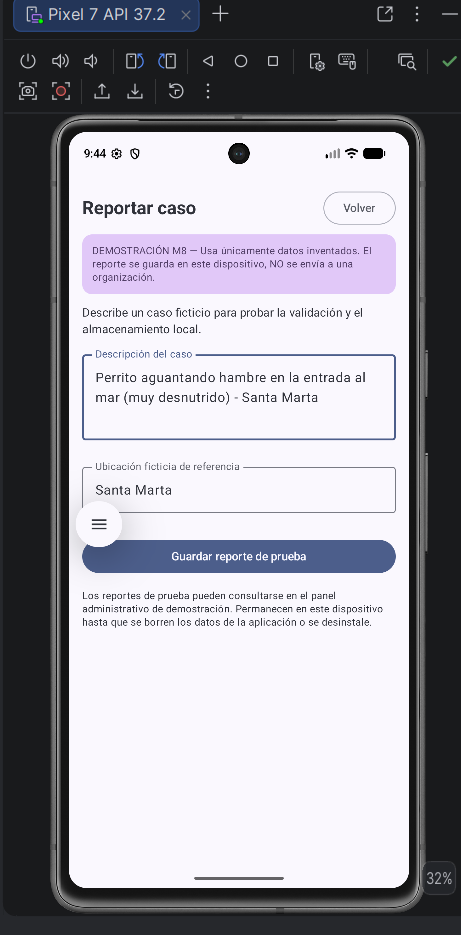
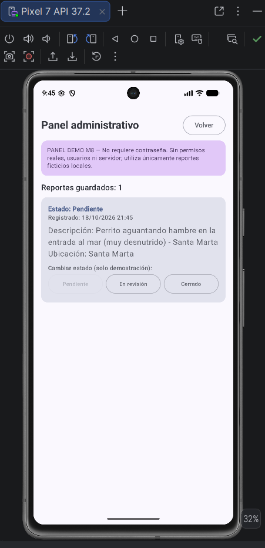
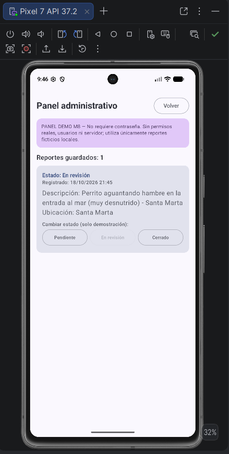
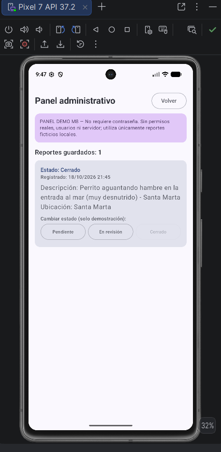
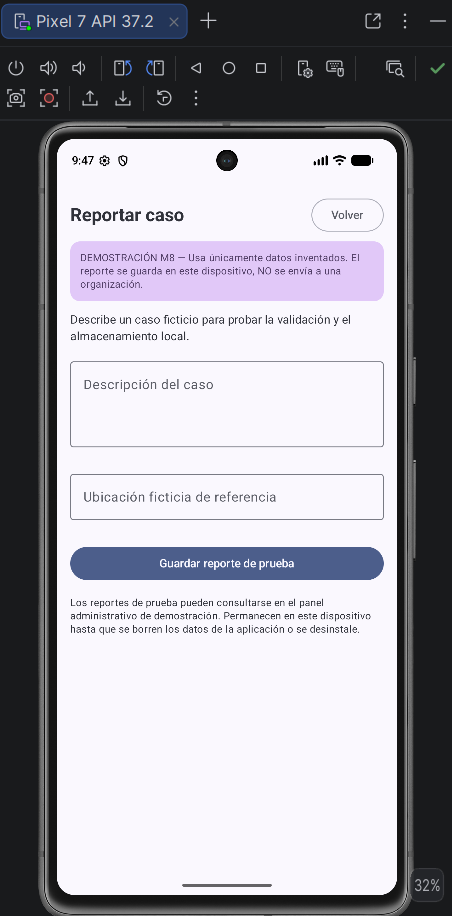

# Huellitas del Viajero

**Proyecto académico de Android — Desarrollo de Apps Móviles (COM-437ES-AVO1)**  
**Johan Dario Tellez Bonilla · Saint Leo University · Octubre de 2026**

Huellitas del Viajero nació como una propuesta para reunir en una misma aplicación información sobre perros en situación vulnerable y ofrecer formas sencillas de conocer sus historias, explorar el apadrinamiento y registrar posibles casos. A lo largo del curso desarrollé la idea hasta convertirla en un prototipo Android navegable, con un formulario funcional y una vista de seguimiento de reportes.

La aplicación utiliza **datos ficticios con fines académicos**. No recibe solicitudes reales de rescate o adopción, no contacta a fundaciones ni procesa pagos.

## 1. Descripción y propósito del proyecto

La idea surgió al observar que la información sobre animales que necesitan ayuda suele encontrarse repartida entre publicaciones, redes sociales y diferentes personas u organizaciones. Esta dispersión puede dificultar la consulta de los casos y su seguimiento. Por eso, planteé una aplicación con una interfaz sencilla que agrupara las opciones más importantes y permitiera representar el proceso desde que se consulta un perfil hasta que se registra un reporte.

En esta etapa el objetivo no es reemplazar el trabajo de las fundaciones, sino mostrar cómo una solución móvil podría organizar la información y facilitar una futura colaboración con ellas.

## 2. Origen y evolución

El primer diseño se realizó en **MIT App Inventor**, donde definí la pantalla de inicio y tres opciones principales: **Ver perritos**, **Apadrinar** y **Reportar caso**. A partir del módulo 5 utilicé ese diseño como referencia para crear una aplicación nueva en **Android Studio**, con Kotlin y Jetpack Compose. No fue una conversión automática desde App Inventor: la interfaz y la navegación se construyeron nuevamente.

**Diseño inicial de la aplicación en MIT App Inventor**



Durante el módulo 5 se desarrollaron las pantallas de inicio, listado y detalle de perfiles ficticios, apadrinamiento informativo y reporte de casos. En el módulo 8 amplié el formulario, incorporé guardado local de reportes y añadí un panel administrativo de demostración para consultarlos y actualizar su estado.

## 3. Plataforma y herramientas

La aplicación se desarrolló para **Android** con **Android Studio, Kotlin, Jetpack Compose y Gradle**. En el proyecto se encuentran configurados `minSdk 24` y `targetSdk 37`.

Las pruebas de la entrega final se realizaron en un **emulador Pixel 7 (API 37.2)**. El registro de los casos ficticios utiliza almacenamiento local mediante `SharedPreferences` y JSON; por el momento no existe una base de datos compartida, servidor remoto ni sincronización con otras personas o dispositivos.

El código fuente se encuentra en [`android/HuellitasDelViajero`](android/HuellitasDelViajero).

## 4. Interfaz del usuario

La pantalla principal conserva las opciones con las que comenzó el proyecto. **Ver perritos** permite consultar perfiles ficticios como Firulais, Luna y Rocky; **Apadrinar** explica una forma posible de colaboración, sin crear compromisos ni realizar transacciones; y **Reportar caso** permite ingresar una descripción y una ubicación de referencia, utilizando únicamente datos inventados.

**Pantalla principal de la versión del módulo 8**



**Pantallas desarrolladas durante el módulo 5**

  

Estas pantallas se conservan como parte de la evolución del prototipo. Las capturas de los avances están organizadas en [`evidencias/modulo-5`](evidencias/modulo-5/) y [`evidencias/modulo-8`](evidencias/modulo-8/).

## 5. Registro de reportes y panel administrativo

Una de las mejoras principales del módulo 8 fue incorporar la posibilidad de **guardar un reporte ficticio en el dispositivo**. El formulario solicita una descripción y una ubicación, verifica los campos obligatorios y muestra mensajes cuando la información está incompleta.

**Formulario de reporte con información de prueba**



El **Panel administrativo (Demo)** muestra los reportes registrados, incluyendo descripción, ubicación, fecha y estado. Desde allí se puede cambiar el seguimiento de cada ejemplo entre **Pendiente**, **En revisión** y **Cerrado**. Esta vista no tiene inicio de sesión ni permisos diferenciados; se diseñó para demostrar el funcionamiento del seguimiento, no como una consola administrativa apta para utilizarse con casos reales.

**Consulta del reporte y cambios de estado**

  

## 6. Pruebas funcionales

En Android Studio comprobé la apertura del prototipo en Pixel 7, la disponibilidad del menú principal, el registro de un caso ficticio y su visualización en el panel administrativo. También cambié el estado del reporte y verifiqué que el formulario mostrara errores cuando se intentaba guardar sin completar los campos obligatorios.

**Validación de campos vacíos**



El almacenamiento local forma parte del código de esta versión. La conservación del reporte después de cerrar y volver a abrir completamente la aplicación no cuenta con una captura específica dentro de las evidencias de esta entrega, por lo que se diferencia de las comprobaciones visuales realizadas.

El detalle de las pruebas se encuentra en [`PRUEBAS_M8.md`](PRUEBAS_M8.md).

## 7. Diseño y navegación

El recorrido comienza en la pantalla principal, desde donde se accede a las tres funciones originales y al panel de seguimiento incorporado en el módulo 8.

```text
                           HUELLITAS DEL VIAJERO
                                   Inicio
                                     │
                  ┌──────────────────┼─────────────────┐
                  │                  │                 │
             Ver perritos         Apadrinar        Reportar caso
                  │             (informativo)          │
             Lista ficticia                         Validación
                  │                                   │
             Ver detalle                         Guardado local
                                                      │
                                    Panel administrativo (Demo)
                                                      │
                                          Consultar y cambiar estado
                                       Pendiente / En revisión / Cerrado
```

Los esquemas y las capturas permiten identificar las pantallas, sus relaciones y el comportamiento previsto para cada recorrido. El panel administrativo es una función de demostración accesible desde el mismo prototipo.

## 8. Registro de cambios y estado del proyecto

El desarrollo comenzó con el wireframe en MIT App Inventor, continuó con una primera aplicación Android navegable en el módulo 5 y terminó con las mejoras funcionales y la documentación del módulo 8.

Entre los avances finales se encuentran la validación del formulario, el almacenamiento local de reportes ficticios, el panel de consulta y los estados de seguimiento. El historial de los cambios se documenta en [`CHANGELOG.md`](CHANGELOG.md).

Huellitas del Viajero sigue siendo un **prototipo académico**. Antes de utilizarlo con situaciones reales sería indispensable incorporar autenticación, protección de datos, validación de reportes, permisos de uso de imágenes y un proceso de coordinación con organizaciones de bienestar animal.

## 9. Documentación y entregables

El desarrollo, las evidencias y el análisis del proyecto se encuentran organizados en este repositorio:

- **[Informe final del módulo 8](documentos/M8%20Entrega%20final%20de%20la%20aplicaci%C3%B3n%20de%20Android%20-%20Johan%20Tellez.docx)** — descripción, problemática, plataforma, interfaces, funcionalidad y diseño.
- **[Presentación del proyecto](presentacion/M8%20Presentacion%20Huellitas%20del%20Viajero%20-%20Johan%20Tellez.pptx)** — síntesis de la propuesta y sus posibilidades de desarrollo.
- **[Borrador del informe](documentos/M8_borrador_informe.md)** — versión de trabajo del proyecto.
- **[Registro de cambios](CHANGELOG.md)** y **[pruebas funcionales](PRUEBAS_M8.md)** — evolución y comprobaciones del prototipo.
- **[Índice documental del módulo 8](documentos/M8_entrega_tipo_wiki.md)** — acceso a los apartados de la entrega.

El registro audiovisual de la exposición, **M8 Presentacion Huellitas del Viajero - Johan Tellez.mp4**, es un material complementario que se conserva por separado del repositorio de código.

## 10. Conclusión

Durante el curso, Huellitas del Viajero pasó de ser una idea representada en un wireframe a una aplicación Android que permite recorrer pantallas, registrar un ejemplo y consultar su seguimiento. El desarrollo me permitió relacionar el diseño de interfaces con la programación y, sobre todo, comprobar que una función no está completa únicamente porque aparezca en pantalla: también debe responder correctamente a las acciones del usuario.

Considero que el proyecto puede servir como punto de partida para una solución de mayor alcance, siempre que su evolución se acompañe de pruebas, seguridad y una participación real de organizaciones dedicadas a la protección animal.
